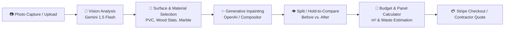

# Building Innovation AI

**AI-Powered Architectural Visualization, Material Estimation & Contractor Commerce Platform**

🌐 **Web Application:** [buildingapp.us](https://buildingapp.us) · [buildinginnovation.us](https://buildinginnovation.us)  
📱 **Mobile Application:** Android Release Bundle (Capacitor native wrapper · Google Play Console `versionCode 7` / v1.0.6)

---

## 📖 Executive Summary & Core Capabilities

Building Innovation AI is an end-to-end commercial and architectural platform built for homeowners, contractors, architects, and building material distributors. It transforms a simple smartphone photo into a photorealistic room remodel, computes exact panel/box counts and budgets, and facilitates direct contractor quoting and material purchasing.



---

## 🎯 Capabilities vs. Code Architecture

This guide explains how every feature is represented and implemented across the codebase.

### 1. User Experience & Visualizer Flow

| Capability | What the User Experiences | Code Implementation & Location |
| :--- | :--- | :--- |
| **Photo Capture & Upload** | Live camera capture or upload from gallery. Works flawlessly across iOS, Android, and web. | [`CameraCapture.tsx`](file:///C:/Users/jasme/.gemini/antigravity/Building-Innovation-AI-main-updated/components/CameraCapture.tsx) · [`WebcamCapture.tsx`](file:///C:/Users/jasme/.gemini/antigravity/Building-Innovation-AI-main-updated/components/WebcamCapture.tsx)<br>Native Android permissions (`CAMERA`, `READ_MEDIA_IMAGES`) declared in [`AndroidManifest.xml`](file:///C:/Users/jasme/.gemini/antigravity/Building-Innovation-AI-main-updated/android/app/src/main/AndroidManifest.xml). |
| **Smart Downscaling (Zero Timeout)** | Even massive 15–24MP camera photos upload in ~1 second with zero timeouts over mobile networks. | `downscaleImage()` in [`App.tsx`](file:///C:/Users/jasme/.gemini/antigravity/Building-Innovation-AI-main-updated/App.tsx) compresses images to 1024px @ 85% JPEG before dispatching to `/api/ai/analyze-room`, bypassing 45s HTTP abort limits. |
| **AI Room Analysis** | Automatic room scanning: extracts estimated dimensions (width, height, area in m²), architectural style, lighting, and suggested materials. | [`services/geminiService.ts`](file:///C:/Users/jasme/.gemini/antigravity/Building-Innovation-AI-main-updated/services/geminiService.ts) -> `/api/ai/analyze-room` in [`server/index.ts`](file:///C:/Users/jasme/.gemini/antigravity/Building-Innovation-AI-main-updated/server/index.ts) using Gemini vision. |
| **Surface Scope Selector** | Users can choose where materials go: **Pared Acento (Accent Wall)**, **Todas Paredes (All Walls)**, or **Pisos (Floors)**. | Segmented control in [`App.tsx`](file:///C:/Users/jasme/.gemini/antigravity/Building-Innovation-AI-main-updated/App.tsx) (`targetSurface` state). Automatically combines prompt rules into the AI inpaint instructions. |
| **1-Tap Style & Prompt Chips** | One-tap style pills: 🌿 *Add indoor plants*, 💡 *Warm LED lighting*, 🛋️ *Modern minimalist*, 🌙 *Luxury evening*, 🧹 *Clean space*. | Interactive chip state in [`App.tsx`](file:///C:/Users/jasme/.gemini/antigravity/Building-Innovation-AI-main-updated/App.tsx). Tapping a chip highlights it in purple and dynamically appends or removes the tag from `customPrompt`. |
| **Texture Zoom & Inspector** | Click any material to inspect grain, relief, reflection, and finish up to 300% zoom with technical specs. | `renderProbeModal` in [`App.tsx`](file:///C:/Users/jasme/.gemini/antigravity/Building-Innovation-AI-main-updated/App.tsx). Features scale transforms, zoom buttons (+ / - / Reset), and specs badges (dimensions, thickness, unit price). |
| **Photorealistic AI Inpainting** | Materials seamlessly wrap walls with realistic shadows and perspective while preserving furniture, windows, and plants. | `generateMaterialOverlay()` in [`services/geminiService.ts`](file:///C:/Users/jasme/.gemini/antigravity/Building-Innovation-AI-main-updated/services/geminiService.ts) -> `/api/ai/generate-overlay` in [`server/services/aiProviders.ts`](file:///C:/Users/jasme/.gemini/antigravity/Building-Innovation-AI-main-updated/server/services/aiProviders.ts) using OpenAI inpainting with surface masks. |
| **Hold-to-Compare & Split Slider** | Drag handle for split-view OR press and hold **"Mantén para ver Original"** to instantly flick between before and after. | [`components/ImageComparator.tsx`](file:///C:/Users/jasme/.gemini/antigravity/Building-Innovation-AI-main-updated/components/ImageComparator.tsx). Uses dynamic clip-paths, touch/mouse listeners, and top quick-toggle mode pills (`[Original \| Split \| AI Render]`). |
| **Real-time Budget Estimator** | In-editor card displays live wall area, required panels (with 5% waste buffer), and estimated dollar cost. | Smart Estimate badge in [`App.tsx`](file:///C:/Users/jasme/.gemini/antigravity/Building-Innovation-AI-main-updated/App.tsx) calculates: `pieces = ceil(areaM2 * 1.05 / pieceArea)` and connects directly to quote breakdown. |
| **Mobile Haptic Feedback** | Subtle vibrations when selecting materials, changing scopes, and when generation finishes. | [`utils/haptics.ts`](file:///C:/Users/jasme/.gemini/antigravity/Building-Innovation-AI-main-updated/utils/haptics.ts) using the Web Vibration API (`navigator.vibrate`), safe on both desktop and mobile WebViews. |

---

### 2. Commercial & Administrative Operations

| Capability | What the Admin / Business Manages | Code Implementation & Location |
| :--- | :--- | :--- |
| **User & Quota Administration** | Inspect registered users, manage tier levels (*FREE, STANDARD, PREMIUM, LUXURY*), view renders used, and adjust quotas. | `renderAdmin()` in [`App.tsx`](file:///C:/Users/jasme/.gemini/antigravity/Building-Innovation-AI-main-updated/App.tsx) -> `/api/admin/users` & `/api/admin/tiers` in [`server/index.ts`](file:///C:/Users/jasme/.gemini/antigravity/Building-Innovation-AI-main-updated/server/index.ts). |
| **Material Catalog Management** | Add new products, adjust pricing per unit or box, modify dimensions, change usage (Interior/Exterior), and update texture URLs. | Catalog CRUD handlers in [`App.tsx`](file:///C:/Users/jasme/.gemini/antigravity/Building-Innovation-AI-main-updated/App.tsx) -> `/api/materials` in [`server/index.ts`](file:///C:/Users/jasme/.gemini/antigravity/Building-Innovation-AI-main-updated/server/index.ts). |
| **Purchase & Order Tracking** | View and fulfill orders submitted through Stripe live checkout or generated via email quote requests. | [`components/AdminPurchaseQueue.tsx`](file:///C:/Users/jasme/.gemini/antigravity/Building-Innovation-AI-main-updated/components/AdminPurchaseQueue.tsx) -> `/api/purchase-requests` in [`server/index.ts`](file:///C:/Users/jasme/.gemini/antigravity/Building-Innovation-AI-main-updated/server/index.ts). |
| **Contractor Network** | Browse and assign verified regional contractors in Colombia (Bogotá, Medellín, Cali, etc.) with custom labor rates per m². | [`components/EstimationPanel.tsx`](file:///C:/Users/jasme/.gemini/antigravity/Building-Innovation-AI-main-updated/components/EstimationPanel.tsx) with contractor data defined in [`constants.ts`](file:///C:/Users/jasme/.gemini/antigravity/Building-Innovation-AI-main-updated/constants.ts). |
| **Audit Logging & Security** | Comprehensive security audit log tracking admin logins, quota overrides, material updates, and IP addresses. | `renderAuditLogsComponent()` in [`App.tsx`](file:///C:/Users/jasme/.gemini/antigravity/Building-Innovation-AI-main-updated/App.tsx) -> `/api/admin/audit-logs` in [`server/index.ts`](file:///C:/Users/jasme/.gemini/antigravity/Building-Innovation-AI-main-updated/server/index.ts). |

---

## 🏗️ Technical Architecture & Repository Layout

```
├── App.tsx                      # Primary application entry point & view router
├── types.ts                     # TypeScript definitions for Materials, Users, Analysis, Cart
├── constants.ts                 # Initial catalog items, translations (EN/ES), contractor registry
├── components/
│   ├── ImageComparator.tsx      # Split-screen comparison & Touch & Hold original view
│   ├── EstimationPanel.tsx      # Full contractor quotation & m² calculator panel
│   ├── ProductCard.tsx          # Catalog item card with actions (Quote, Add to Cart, Select)
│   ├── CameraCapture.tsx        # Camera and file input modal handler
│   ├── WebcamCapture.tsx        # Live HTML5 video stream with facingMode switch
│   ├── AdminPurchaseQueue.tsx   # Admin purchase queue & fulfillment dashboard
│   └── Button.tsx               # Reusable styled UI button with loading and disabled states
├── utils/
│   └── haptics.ts               # Web Vibrate API wrapper for native haptic feedback
├── services/
│   ├── geminiService.ts         # Client AI abstraction for room analysis and material inpainting
│   └── unitUtils.ts             # Metric / Imperial conversion utilities
├── server/
│   ├── index.ts                 # Express.js REST API, authentication, Stripe, and admin routes
│   └── services/
│       ├── aiProviders.ts       # Multi-provider routing (Gemini vision, OpenAI inpaint, Flux, local)
│       └── imageCompositor.ts   # Local Sharp-based rendering fallback
└── android/                     # Capacitor native Android studio project
    └── app/src/main/
        └── AndroidManifest.xml  # Camera & Gallery permissions for Google Play Store release
```

---

## ⚙️ Environment Variables Configuration

Create a `.env` file in the root directory:

```ini
# --- Server Environment ---
PORT=3000
NODE_ENV=production

# --- AI Providers ---
AI_PROVIDER=gemini               # 'gemini' | 'openai' | 'openrouter'
GEMINI_API_KEY=AQ.Ab8RN...       # Google Vertex AI / Cloud Service Key
OPENAI_API_KEY=sk-...            # OpenAI API Key (required for photorealistic inpainting)

# --- Database ---
DB_HOST=localhost
DB_USER=root
DB_PASSWORD=your_password
DB_NAME=building_innovation
DB_PORT=3306
DATABASE_URL=postgresql://...    # Optional PostgreSQL connection string

# --- Payments (Stripe) ---
STRIPE_SECRET_KEY=sk_live_...
STRIPE_PUBLISHABLE_KEY=pk_live_...
STRIPE_WEBHOOK_SECRET=whsec_...
STRIPE_PRICE_PRO=price_...
STRIPE_PRICE_ENTERPRISE=price_...

# --- Notifications ---
TELEGRAM_BOT_TOKEN=...
TELEGRAM_CHAT_ID=...
SMTP_HOST=smtp.hostinger.com
SMTP_USER=admin@buildingapp.us
SMTP_PASS=...
```

---

## 🛠️ Build & Deployment Commands

### Local Development
```bash
npm install
npm run dev
# Starts backend server (tsx server/index.ts) and frontend (vite) concurrently
```

### Production Build
```bash
# Build frontend bundle into dist/
npm run build:frontend

# Bundle backend into dist-server/app.cjs using esbuild
npm run build:server

# Run the compiled production app
npm start
```

### Android Native Builds (Capacitor)
```bash
# 1. Build latest frontend assets
npm run build:frontend

# 2. Sync web assets into the Android native project
npx cap sync android

# 3. Build signed Release APK & App Bundle (AAB) for Google Play Console
$env:JAVA_HOME="C:\Program Files\Android\Android Studio\jbr"
cd android
.\gradlew.bat clean bundleRelease assembleRelease
```
* The signed App Bundle output is located at: `android/app/build/outputs/bundle/release/app-release.aab`
* The standalone installable APK output is located at: `android/app/build/outputs/apk/release/app-release.apk`

---

## 🔒 Security & Deployment Notes

1. **Google Play Store Compliance:** Android permissions are strictly scoped to user-initiated image selection (`CAMERA`, `READ_MEDIA_IMAGES`). Legacy storage permissions (`READ_EXTERNAL_STORAGE`, `WRITE_EXTERNAL_STORAGE`) are capped with `maxSdkVersion` for backwards compatibility, and video permissions are omitted since the app only processes still images. No advertising ID permissions (`AD_ID`) are declared.
2. **CORS Whitelist:** Backend strictly permits connections from `https://buildingapp.us`, `https://buildinginnovation.us`, `http://localhost:5173`, `http://localhost:3000`, `capacitor://localhost`, and `https://localhost`.
3. **Asset Proxying:** Dynamic image URLs served within the native Android WebView are converted to absolute paths (`https://buildingapp.us/api/proxy-image?url=...`) via `proxyImageUrl()` in [`App.tsx`](file:///C:/Users/jasme/.gemini/antigravity/Building-Innovation-AI-main-updated/App.tsx) to prevent WebView `localhost` path resolution errors.
4. **Keystore Security:** Production release signing configurations read secrets dynamically from environment variables (`KEYSTORE_STORE_PASSWORD`, `KEYSTORE_KEY_PASSWORD`, `KEYSTORE_KEY_ALIAS`) rather than hardcoded credentials.

